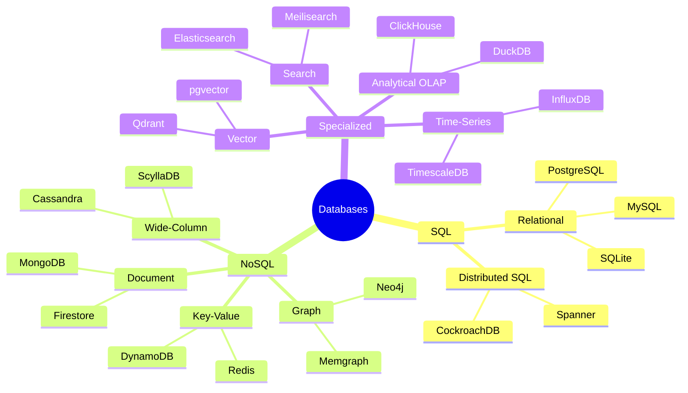
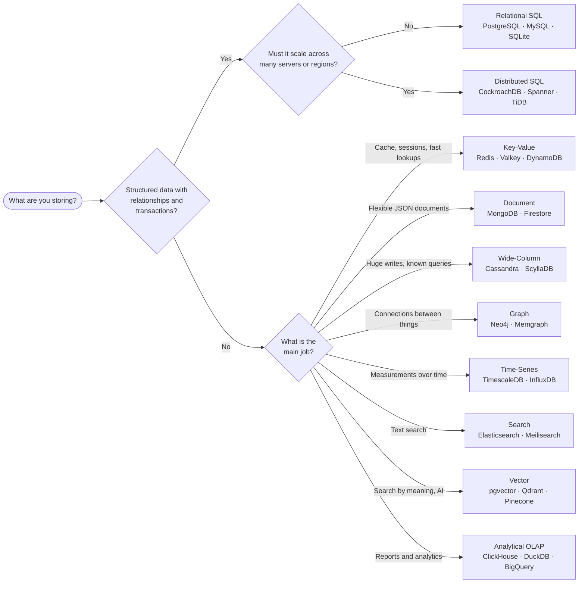

# Databases

Databases grouped by type, with a quick guide on when to use each, plus resources for learning how databases work.

[← Back to Backend](README.md)

<!--
  How to add an entry:
  - Format: - **[Database Name](https://link)** – What it is and what it's good at.
  - Link to the official website.
  - Put it under the type that fits best. A new type? Add a "## Heading" with
    "Use when", "Pros" and "Cons" lines, in the same style as the others.
  - Types are ordered from most common to more specialized. Learning resources stay at the bottom.
  - Adding a new type? Also add it to the Quick Guide table, the Database Map and the flowchart below.
  - Keep entries inside each section sorted alphabetically by name (A → Z).
  - Search the repository first to avoid duplicates.
-->

## Quick Guide

| Type | Best for | Examples |
| --- | --- | --- |
| [Relational (SQL)](#relational-sql) | Most apps; structured data with relationships | PostgreSQL, MySQL, SQLite |
| [Distributed SQL](#distributed-sql) | SQL that must scale across regions | CockroachDB, Spanner, TiDB |
| [Key-Value & In-Memory](#key-value--in-memory) | Caching, sessions, very fast lookups | Redis, Valkey, DynamoDB |
| [Document](#document) | Flexible, nested JSON-like data | MongoDB, Firestore |
| [Wide-Column](#wide-column) | Huge write-heavy workloads at scale | Cassandra, ScyllaDB |
| [Graph](#graph) | Highly connected data and relationships | Neo4j, Memgraph |
| [Time-Series](#time-series) | Metrics, IoT and events over time | TimescaleDB, InfluxDB |
| [Search](#search) | Full-text search and filtering | Elasticsearch, Meilisearch |
| [Vector](#vector) | AI similarity search, RAG, recommendations | pgvector, Qdrant, Pinecone |
| [Analytical (OLAP)](#analytical-olap) | Reports and analytics over large data | ClickHouse, DuckDB, BigQuery |

**Not sure?** Start with PostgreSQL. It handles most workloads well and has extensions for search, vectors and time-series, so add a specialized database only when you hit a real limit.

## Database Map

How the types fit together: classic **SQL**, the **NoSQL** family, and **specialized** databases built for one job.

## Which Database Should I Use?

Follow the questions from left to right to find a good starting point.

Real systems often combine several. A common setup is PostgreSQL as the main database, Redis for caching, and a search or vector database alongside.

## Relational (SQL)

**Use when:** your data has a clear structure and relationships (users, orders, payments), and you need correct transactions.
**Pros:** strong consistency (ACID), powerful SQL queries and joins, mature tools and huge community.
**Cons:** schema changes need migrations; scaling writes beyond one machine is harder.

- **[MariaDB](https://mariadb.org)** – Community-driven fork of MySQL, compatible with most MySQL apps.
- **[Microsoft SQL Server](https://www.microsoft.com/en-us/sql-server)** – Microsoft's enterprise database, common in .NET and corporate environments.
- **[MySQL](https://www.mysql.com)** – Hugely popular open-source database behind much of the web.
- **[Oracle Database](https://www.oracle.com/database/)** – Long-standing enterprise database used by large companies and banks.
- **[PostgreSQL](https://www.postgresql.org)** – Powerful open-source database with rich features and extensions; the default choice for many teams.
- **[SQLite](https://www.sqlite.org)** – Tiny database stored in a single file inside your app; great for mobile, desktop and small sites.

## Distributed SQL

**Use when:** you want SQL and transactions but need to scale across many machines or regions.
**Pros:** horizontal scaling, high availability, survives server or region failures.
**Cons:** more complex and costly to run; some queries are slower than on a single machine.

- **[CockroachDB](https://www.cockroachlabs.com)** – PostgreSQL-compatible distributed SQL database built to survive failures.
- **[Google Cloud Spanner](https://cloud.google.com/spanner)** – Google's globally distributed, strongly consistent SQL database.
- **[Neon](https://neon.com)** – Serverless PostgreSQL that scales to zero and supports instant branching.
- **[PlanetScale](https://planetscale.com)** – Managed, horizontally scalable MySQL and PostgreSQL hosting.
- **[Supabase](https://supabase.com)** – PostgreSQL platform with auth, storage and APIs built in; popular as a Firebase alternative.
- **[TiDB](https://www.pingcap.com)** – MySQL-compatible distributed SQL database for mixed transactional and analytical work.
- **[YugabyteDB](https://www.yugabyte.com)** – PostgreSQL-compatible distributed database for global apps.

## Key-Value & In-Memory

**Use when:** you need very fast reads and writes by key, such as caching, sessions, rate limits, queues or leaderboards.
**Pros:** extremely fast and simple to use, scales easily.
**Cons:** limited querying (mostly look up by key); in-memory data can be lost without proper persistence.

- **[Amazon DynamoDB](https://aws.amazon.com/dynamodb/)** – Fully managed key-value database on AWS with predictable speed at any scale.
- **[etcd](https://etcd.io)** – Reliable key-value store for configuration and coordination; the brain of Kubernetes.
- **[Memcached](https://memcached.org)** – Simple, fast in-memory cache.
- **[Redis](https://redis.io/docs/latest/)** – In-memory data store for caching, queues, pub/sub and more.
- **[RocksDB](https://rocksdb.org)** – Embedded key-value storage engine used inside many other databases.
- **[Valkey](https://valkey.io)** – Open-source fork of Redis backed by the Linux Foundation.

## Document

**Use when:** your data is naturally JSON-like and its shape changes often, such as product catalogs, content or user profiles.
**Pros:** flexible schema, easy to start, data stored the way your app uses it.
**Cons:** joins across documents are weaker; data can get duplicated and inconsistent without care.

- **[Cloud Firestore](https://firebase.google.com/products/firestore)** – Google's real-time document database for mobile and web apps.
- **[Couchbase](https://www.couchbase.com)** – Document database with built-in caching and SQL-like queries.
- **[MongoDB](https://www.mongodb.com)** – The most popular document database, with flexible JSON-style documents.

## Wide-Column

**Use when:** you have huge volumes of writes and know your query patterns in advance, such as messaging, activity feeds or IoT.
**Pros:** massive scale, high write speed, no single point of failure.
**Cons:** you must design tables around your queries; no joins and limited ad-hoc queries.

- **[Apache Cassandra](https://cassandra.apache.org)** – Distributed wide-column database used for massive write-heavy workloads.
- **[Apache HBase](https://hbase.apache.org)** – Wide-column store built on Hadoop for very large tables.
- **[Google Cloud Bigtable](https://cloud.google.com/bigtable)** – Google's managed wide-column database, the one behind Search and Maps.
- **[ScyllaDB](https://www.scylladb.com)** – Cassandra-compatible database rewritten in C++ for lower latency.

## Graph

**Use when:** relationships are the main point, such as social networks, recommendations, fraud detection or knowledge graphs.
**Pros:** fast multi-hop queries ("friends of friends"), natural way to model connected data.
**Cons:** less common skills and tools; not ideal for simple tables or heavy aggregations.

- **[Amazon Neptune](https://aws.amazon.com/neptune/)** – Managed graph database on AWS.
- **[ArangoDB](https://arangodb.com)** – Multi-model database combining graph, document and key-value.
- **[Memgraph](https://memgraph.com)** – Fast in-memory graph database compatible with Neo4j's query language.
- **[Neo4j](https://neo4j.com)** – The most popular graph database, using the Cypher query language.

## Time-Series

**Use when:** you store measurements over time, such as metrics, sensor data, stock prices or logs.
**Pros:** fast writes and time-based queries, automatic compression and data retention.
**Cons:** specialized; less suited to general app data or complex updates.

- **[InfluxDB](https://www.influxdata.com)** – Popular purpose-built time-series database.
- **[QuestDB](https://questdb.com)** – High-performance time-series database with SQL.
- **[TimescaleDB](https://www.tigerdata.com)** – Time-series extension for PostgreSQL, now from Tiger Data.
- **[VictoriaMetrics](https://victoriametrics.com)** – Efficient time-series database for monitoring, compatible with Prometheus.

## Search

**Use when:** users need to search text with typos, ranking, filters and facets, such as site or product search.
**Pros:** relevance ranking, fuzzy matching, fast filtering over large text.
**Cons:** usually not your main source of truth; needs syncing with your primary database.

- **[Elasticsearch](https://www.elastic.co/elasticsearch)** – Widely used distributed search and analytics engine.
- **[Meilisearch](https://www.meilisearch.com)** – Fast, easy-to-set-up search engine with great defaults.
- **[OpenSearch](https://opensearch.org)** – Open-source search and analytics suite forked from Elasticsearch.
- **[Typesense](https://typesense.org)** – Typo-tolerant open-source search, a simple alternative to Algolia.

## Vector

**Use when:** you search by meaning instead of exact words, such as AI chatbots over your documents (RAG), semantic search or recommendations.
**Pros:** finds similar items quickly across millions of embeddings.
**Cons:** results are approximate; a dedicated vector database adds another system to run (pgvector avoids that).

- **[Chroma](https://www.trychroma.com)** – Open-source, easy-to-start embedding database for AI apps.
- **[Milvus](https://milvus.io)** – Open-source vector database built for very large scale.
- **[pgvector](https://github.com/pgvector/pgvector)** – Adds vector similarity search to PostgreSQL.
- **[Pinecone](https://www.pinecone.io)** – Managed vector database for search and RAG at scale.
- **[Qdrant](https://qdrant.tech)** – Fast open-source vector search engine written in Rust.
- **[Weaviate](https://weaviate.io)** – Open-source vector database with built-in hybrid search.

## Analytical (OLAP)

**Use when:** you run reports, dashboards or analysis over millions to billions of rows.
**Pros:** very fast aggregations thanks to columnar storage and compression.
**Cons:** not built for many small updates or app transactions; often loaded in batches.

- **[Apache Druid](https://druid.apache.org)** – Real-time analytics database for fast queries on streaming data.
- **[ClickHouse](https://clickhouse.com)** – Very fast open-source column-oriented database for analytics.
- **[DuckDB](https://duckdb.org)** – In-process analytics database, like SQLite for analysis on your laptop.
- **[Google BigQuery](https://cloud.google.com/bigquery)** – Serverless data warehouse on Google Cloud.
- **[Snowflake](https://www.snowflake.com)** – Cloud data warehouse that separates storage and compute.

## Learning Resources

- **[CMU Intro to Database Systems](https://15445.courses.cs.cmu.edu)** – Andy Pavlo's free course on how databases work inside.
- **[Database Internals](https://www.databass.dev)** – Book on storage engines and distributed databases.
- **[DB-Engines Ranking](https://db-engines.com/en/ranking)** – Monthly popularity ranking of databases, filterable by type.
- **[How SQLite Works](https://www.sqlite.org/howitworks.html)** – Short official explanation of SQLite's internals.
- **[Jepsen](https://jepsen.io)** – Deep tests showing how real databases behave (and break) under failures.
- **[The Internals of PostgreSQL](https://www.interdb.jp/pg/)** – Free online book explaining how PostgreSQL works under the hood.
- **[Use The Index, Luke](https://use-the-index-luke.com)** – Free guide to SQL indexing and query performance for developers.
