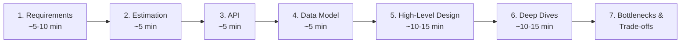

# System Design Interviews

How system design interviews work, a step-by-step framework, a numbers cheat sheet and the most commonly asked questions, grouped by category with the key ideas to discuss. For the concepts themselves, see [System Design](system-design.md).

[← Back to Backend](README.md)

<!--
  How to contribute:
  - Adding a question: put it in the matching category table with the key concepts to discuss.
    Keep rows sorted alphabetically by question.
  - Links: - **[Resource Name](https://link)** – One-line description, sorted alphabetically (A → Z).
  - Search the repository first to avoid duplicates.
-->

## Contents

1. [How the Interview Works](#how-the-interview-works)
2. [The Framework](#the-framework)
3. [Numbers Cheat Sheet](#numbers-cheat-sheet)
4. [Most Asked Questions](#most-asked-questions)
5. [Common Mistakes](#common-mistakes)
6. [Prep Resources](#prep-resources)

## How the Interview Works

- **Format** – Usually 45–60 minutes of open-ended discussion on a whiteboard or drawing tool, such as "Design a URL shortener" or "Design WhatsApp."
- **No single right answer** – Interviewers look at how you handle ambiguity, make trade-offs, think about scale and communicate.
- **Level matters** – Junior candidates are expected to build a working design; senior candidates are expected to drive the conversation, spot bottlenecks early and go deep on trade-offs.
- **Two common flavors** – *Product design* (build an app like Instagram or Uber) and *infrastructure design* (build a rate limiter, cache or message queue).

## The Framework

Use the same structure every time so you never freeze.

1. **Clarify requirements** – *Functional:* the 3–5 core features ("users can post, follow and see a feed"). *Non-functional:* scale, latency, availability vs consistency, durability. Agree on what's out of scope.
2. **Estimate scale** – Users, requests per second (reads vs writes), storage per year and bandwidth. Rough numbers are fine; they guide your choices.
3. **Define the API** – The main endpoints or calls, with inputs and outputs (e.g. `POST /tweets`, `GET /feed?cursor=`).
4. **Design the data model** – Main entities, how they relate and which database fits (SQL vs NoSQL and why).
5. **Draw the high-level design** – Clients, load balancer, services, databases, caches, queues. Walk through one request end to end.
6. **Deep dive** – Go deeper on the hardest parts: scaling the database, caching, hot spots, consistency, failure handling. Let the interviewer steer.
7. **Discuss bottlenecks and trade-offs** – Single points of failure, what breaks at 10x scale, monitoring, and what you'd do with more time.

**Non-functional checklist:** scalability · latency · availability · consistency · durability · security · cost · observability.

## Numbers Cheat Sheet

Approximate numbers for quick back-of-the-envelope math.

**Time and traffic**

| Fact | Value |
| --- | --- |
| Seconds in a day | ~86,400 ≈ 10⁵ |
| 1 million requests/day | ≈ 12 requests/second |
| 100 million requests/day | ≈ 1,200 requests/second |
| Peak traffic | Often 2–3× the average |

**Data sizes**

| Unit | Bytes |
| --- | --- |
| 1 KB (thousand) | 10³ |
| 1 MB (million) | 10⁶ |
| 1 GB (billion) | 10⁹ |
| 1 TB (trillion) | 10¹² |
| 1 PB | 10¹⁵ |

**Rough latencies**

| Operation | Approx. time |
| --- | --- |
| Read from memory | ~100 ns |
| SSD random read | ~16–100 μs |
| Round trip within a data center | ~0.5 ms |
| Read 1 MB from SSD | ~1 ms |
| Disk seek (HDD) | ~10 ms |
| Round trip US ↔ Europe | ~150 ms |

**Availability ("nines")**

| Availability | Downtime per year | Downtime per month |
| --- | --- | --- |
| 99% | ~3.65 days | ~7.3 hours |
| 99.9% | ~8.77 hours | ~43.8 minutes |
| 99.99% | ~52.6 minutes | ~4.4 minutes |
| 99.999% | ~5.26 minutes | ~26 seconds |

For more latency numbers, see [Latency Numbers Every Programmer Should Know](../Learning/articles.md#engineering).

## Most Asked Questions

Grouped by category, with the key ideas interviewers usually expect you to discuss. Concepts link to the [System Design](system-design.md) guide.

### Classic Starters

| Question | Key concepts to discuss |
| --- | --- |
| Design a distributed cache | Consistent hashing, eviction (LRU), replication, hot keys |
| Design a key-value store | Partitioning, replication, quorums, conflict resolution, LSM trees |
| Design a rate limiter | Token bucket vs sliding window, Redis counters, distributed limits, 429 responses |
| Design a unique ID generator | UUIDv7 vs Snowflake IDs, clock skew, no single point of failure |
| Design a URL shortener (TinyURL) | Base62 encoding, ID generation, read-heavy caching, 301 vs 302 redirects, analytics |
| Design Pastebin | Object storage for content, expiry, unique keys, CDN |

### Social & Content

| Question | Key concepts to discuss |
| --- | --- |
| Design a leaderboard | Redis sorted sets, sharding by game or region, real-time updates |
| Design a news feed (Facebook, X) | Fan-out on write vs read, the celebrity problem, feed ranking, caching |
| Design Instagram | Media upload to object storage, CDN, feed generation, followers graph |
| Design likes and view counters | Counter sharding, batching writes, approximate counts, eventual consistency |
| Design top-K / trending topics | Stream processing, count–min sketch, sliding time windows |

### Messaging & Real-Time

| Question | Key concepts to discuss |
| --- | --- |
| Design a chat app (WhatsApp, Messenger) | WebSockets, message ordering, delivery and read receipts, online presence, group chats, offline storage |
| Design a notification system | Push, email and SMS channels, queues, retries, user preferences, deduplication |
| Design live comments | Pub/sub, WebSockets or SSE, fan-out to many viewers |

### Media & Files

| Question | Key concepts to discuss |
| --- | --- |
| Design Google Drive / Dropbox | File chunking, deduplication, sync and conflicts, metadata database, object storage |
| Design YouTube / Netflix | Upload pipeline, transcoding, adaptive bitrate streaming, CDN, recommendations |

### Location-Based

| Question | Key concepts to discuss |
| --- | --- |
| Design Uber / Lyft | Frequent location updates, geospatial index (geohash, H3), driver matching, surge pricing |
| Design Yelp / nearby places | Geohash or quadtree, read-heavy caching, search and filters |

### Search & Discovery

| Question | Key concepts to discuss |
| --- | --- |
| Design a search engine | Crawling, inverted index, ranking, sharding the index |
| Design a web crawler | URL frontier, politeness per domain, deduplication with Bloom filters, distributed workers |
| Design search autocomplete (typeahead) | Trie, precomputed top suggestions, caching, low latency |

### Commerce & Transactions

| Question | Key concepts to discuss |
| --- | --- |
| Design a hotel or flight booking system | Inventory, reservations with holds, double-booking prevention, consistency |
| Design a payment system | Idempotency keys, double-entry ledger, external payment providers, reconciliation, exactly-once effects |
| Design an ad click aggregator | Stream processing, deduplication, exactly-once counting, time windows |
| Design an e-commerce checkout (Amazon) | Cart, inventory, order saga, payments, flash-sale traffic |
| Design Ticketmaster | Seat holds with timeouts, locking and contention, virtual waiting room, high traffic spikes |

### Infrastructure

| Question | Key concepts to discuss |
| --- | --- |
| Design a distributed job scheduler | Task queues, leader election, retries, exactly-once execution, cron at scale |
| Design a distributed message queue (Kafka) | Partitions, replication, consumer groups, ordering, retention |
| Design a metrics and logging system | High write throughput, time-series storage, aggregation, retention, alerting |

### AI-Era Questions

Increasingly common since 2025 as companies build AI products.

| Question | Key concepts to discuss |
| --- | --- |
| Design a ChatGPT-style chat app | Token streaming (SSE), GPU serving and batching, conversation storage, rate limits by tokens |
| Design a RAG system (chat with your documents) | Document chunking, embeddings, vector database, retrieval and reranking, freshness |
| Design an AI agent platform | Tool calling, long-running tasks, queues, sandboxing, cost and safety limits |

## Common Mistakes

- **Jumping straight to the design** – Always clarify requirements and scale first.
- **Going silent** – Think out loud; the interviewer grades your reasoning, not just the final diagram.
- **Over-engineering** – Start simple, then scale the parts that need it. Not everything needs microservices or Kafka.
- **Ignoring trade-offs** – Every choice has a cost. Say what you gain and what you give up.
- **Hand-waving the hard part** – Be ready to go deep on the database, caching or the main bottleneck.
- **Forgetting failures** – Discuss what happens when a server, database or region goes down.

## Prep Resources

- **[Grokking the System Design Interview](https://www.designgurus.io/course/grokking-the-system-design-interview)** – Popular course walking through common interview problems.
- **[Hello Interview](https://www.hellointerview.com)** – Free system design guides and question breakdowns, plus mock interviews.

ByteByteGo and The System Design Primer are also great for interview prep; they're listed in the [System Design resources](system-design.md#resources).
