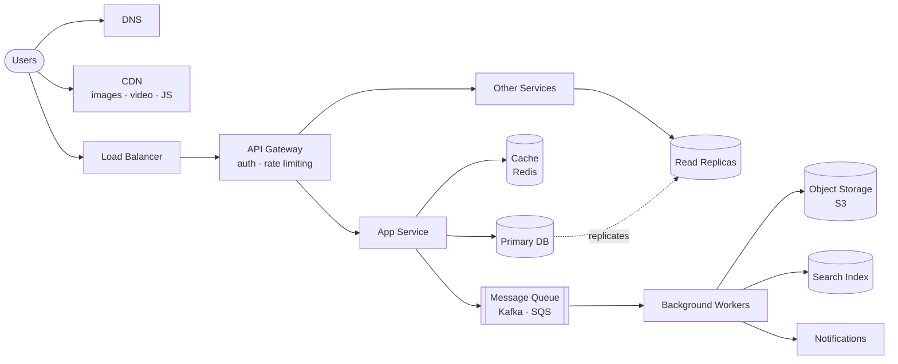

# System Design

The building blocks of large-scale systems, grouped by topic. Each topic has a short explanation, when to use it, the trade-offs and the most widely used tools. Preparing for interviews? See [System Design Interviews](system-design-interviews.md).

[← Back to Backend](README.md)

<!--
  How to contribute:
  - Concepts: keep explanations short (one or two lines) and practical. Add pros/cons where they help.
  - Links: - **[Resource Name](https://link)** – One-line description.
    Prefer free, high-quality sources (official docs, engineering blogs, well-known papers).
  - Topic sections follow the order of the table of contents (from basics to advanced).
    Lists of links inside a section are sorted alphabetically (A → Z).
  - New topic? Add a "## Heading", then add it to the table of contents.
  - Search the repository first to avoid duplicates.
-->

## Contents

1. [Big Picture](#big-picture)
2. [Fundamentals](#fundamentals)
3. [Networking & Communication](#networking--communication)
4. [Load Balancing, Proxies & API Gateways](#load-balancing-proxies--api-gateways)
5. [Caching](#caching)
6. [CDN & Edge](#cdn--edge)
7. [Databases & Storage](#databases--storage)
8. [Authentication & Authorization](#authentication--authorization)
9. [Rate Limiting & Traffic Control](#rate-limiting--traffic-control)
10. [Messaging & Async Processing](#messaging--async-processing)
11. [Data Consistency & Distributed Patterns](#data-consistency--distributed-patterns)
12. [Reliability & Resilience](#reliability--resilience)
13. [Architecture Styles](#architecture-styles)
14. [Search, Location & Special Data Structures](#search-location--special-data-structures)
15. [Observability](#observability)
16. [Security](#security)
17. [Scaling Step by Step](#scaling-step-by-step)
18. [Most Widely Used Tools](#most-widely-used-tools)
19. [Resources](#resources)

## Big Picture

A typical web-scale system. Most designs are some version of this.

## Fundamentals

- **Vertical vs horizontal scaling** – Vertical: a bigger machine (simple, but has a ceiling). Horizontal: more machines (scales further, but needs load balancing and stateless services).
- **Latency vs throughput** – Latency is how long one request takes; throughput is how many requests you handle per second. Optimizing one can hurt the other.
- **Availability** – The share of time a system works, measured in "nines" (99.9% ≈ 8.8 hours of downtime per year; 99.99% ≈ 53 minutes).
- **SLI, SLO, SLA** – Indicator (what you measure, like p99 latency), Objective (your target), Agreement (the promise to customers, with penalties).
- **CAP theorem** – During a network partition, a distributed system must choose between consistency (everyone sees the same data) and availability (every request gets an answer).
- **PACELC** – Extends CAP: even when there is no partition, you trade latency against consistency.
- **Consistency models** – Strong (always the latest data), eventual (copies catch up over time), read-your-writes (you always see your own changes). Stronger is simpler to reason about, but slower.
- **Stateless services** – Keep session data out of app servers (in a cache or database) so any server can handle any request and you can add servers freely.

- **[CAP Theorem](https://en.wikipedia.org/wiki/CAP_theorem)** – The classic trade-off between consistency and availability.
- **[Google SRE: Service Level Objectives](https://sre.google/sre-book/service-level-objectives/)** – How to define SLIs, SLOs and SLAs properly.
- **[PACELC](https://en.wikipedia.org/wiki/PACELC_design_principle)** – The latency-versus-consistency trade-off beyond CAP.

## Networking & Communication

- **DNS** – Turns names (example.com) into IP addresses; also used for simple load balancing and failover between regions.
- **HTTP/1.1 vs HTTP/2 vs HTTP/3** – HTTP/2 sends many requests over one connection; HTTP/3 runs over QUIC (UDP) for faster connections on unreliable networks.
- **REST vs GraphQL vs gRPC** – REST: simple and universal, best for public APIs. GraphQL: clients ask for exactly the fields they need, great for complex UIs, but caching is harder. gRPC: fast binary calls between internal services, but less browser-friendly.
- **Real-time options** – *Short polling* (simple, wasteful), *long polling* (server holds the request until there is news), *Server-Sent Events* (one-way stream from server, great for live feeds and AI token streaming), *WebSockets* (two-way, best for chat, games and collaboration, but connections are stateful and harder to scale).
- **TCP vs UDP** – TCP is reliable and ordered (most APIs); UDP is faster but can drop packets (video calls, games, DNS).

- **[Evolution of HTTP](https://developer.mozilla.org/en-US/docs/Web/HTTP/Guides/Evolution_of_HTTP)** – MDN's history of HTTP/1.1, HTTP/2 and HTTP/3.
- **[Introduction to gRPC](https://grpc.io/docs/what-is-grpc/introduction/)** – How gRPC and Protocol Buffers work.
- **[Real-time Messaging at Slack](https://slack.engineering/real-time-messaging/)** – How Slack delivers messages in real time to millions of users.
- **[Server-Sent Events](https://developer.mozilla.org/en-US/docs/Web/API/Server-sent_events)** – MDN guide to one-way server streaming.
- **[WebSocket API](https://developer.mozilla.org/en-US/docs/Web/API/WebSockets_API)** – MDN guide to two-way real-time connections.
- **[What is DNS?](https://www.cloudflare.com/learning/dns/what-is-dns/)** – Cloudflare's clear explanation of how DNS works.

## Load Balancing, Proxies & API Gateways

- **Load balancer** – Spreads traffic across servers and removes unhealthy ones. *Layer 4* routes by IP and port (very fast); *Layer 7* routes by URL, headers or cookies (smarter, slightly slower).
- **Algorithms** – Round robin (simple), least connections (good for uneven requests), IP hash / consistent hashing (same user goes to the same server).
- **Reverse proxy** – Sits in front of servers to handle TLS, compression, caching and routing (NGINX, Envoy).
- **API gateway** – A single entry point that handles authentication, rate limiting, routing and request logging for many services.
- **Service discovery** – How services find each other's current addresses as instances come and go (DNS, Consul, Kubernetes services).

- **[API Gateway Pattern](https://microservices.io/patterns/apigateway.html)** – When and why to put a gateway in front of microservices.
- **[Envoy](https://www.envoyproxy.io)** – Popular high-performance proxy used in service meshes.
- **[What is a Reverse Proxy?](https://www.cloudflare.com/learning/cdn/glossary/reverse-proxy/)** – Cloudflare's explanation of reverse proxies.
- **[What is Load Balancing?](https://www.cloudflare.com/learning/performance/what-is-load-balancing/)** – How load balancers work and the main algorithms.

## Caching

Store frequently used data in fast memory so you don't recompute or refetch it. Caching appears in almost every design.

**Where to cache:** browser → CDN → API gateway → application memory → distributed cache (Redis) → database cache.

| Strategy | How it works | Pros | Cons |
| --- | --- | --- | --- |
| Cache-aside (lazy loading) | App checks cache; on a miss, reads the DB and fills the cache | Simple; only caches what's used | First request is slow; data can go stale |
| Read-through | Cache itself loads from the DB on a miss | Simpler app code | Needs cache support |
| Write-through | Write to cache and DB together | Cache always fresh | Slower writes |
| Write-back (write-behind) | Write to cache, save to DB later | Very fast writes | Risk of data loss if the cache fails |
| Write-around | Write only to DB; cache fills on read | Avoids caching data nobody reads | Recent writes miss the cache |

- **Eviction policies** – LRU (remove least recently used, the common default), LFU (least frequently used), TTL (expire after a set time).
- **Common problems** – *Cache stampede* (many requests rebuild the same expired key at once; fix with locks or early refresh), *hot keys* (one key gets huge traffic; replicate or split it), *cache penetration* (requests for keys that don't exist; cache empty results or use a Bloom filter), *invalidation* (keeping cache and DB in sync, famously one of the hardest problems).

- **[Caching Best Practices](https://aws.amazon.com/caching/best-practices/)** – AWS guide to caching strategies, TTLs and patterns.
- **[HTTP Caching](https://developer.mozilla.org/en-US/docs/Web/HTTP/Guides/Caching)** – MDN guide to browser and CDN caching with HTTP headers.
- **[Scaling Memcache at Facebook](https://www.usenix.org/conference/nsdi13/technical-sessions/presentation/nishtala)** – Classic paper on running a cache for billions of requests.

## CDN & Edge

- **CDN (Content Delivery Network)** – Copies of your static files (images, video, JS, CSS) on servers around the world, close to users. Cuts latency and load on your servers.
- **Push vs pull CDN** – Push: you upload content ahead of time (good for large, rarely changing files). Pull: the CDN fetches on first request and caches it (simpler, most common).
- **Edge computing** – Running small pieces of code at CDN locations for personalization, auth checks or redirects close to the user.

- **[What is a CDN?](https://www.cloudflare.com/learning/cdn/what-is-a-cdn/)** – Cloudflare's explanation of how CDNs work.

## Databases & Storage

For choosing a database type (SQL, NoSQL, graph, vector and more), see [Databases](databases.md).

- **Indexes** – Make reads fast at the cost of slower writes and extra storage. Most slow queries are missing an index.
- **Replication** – Copies of data on several machines. *Leader–follower* (one writer, many readers; most common), *multi-leader* (writes in several regions; conflicts possible), *leaderless* (any node accepts writes; uses quorums, like Cassandra and Dynamo).
- **Quorum** – With N copies, writing to W and reading from R where W + R > N guarantees you read the latest write.
- **Partitioning / sharding** – Splitting data across machines. *Range-based* (good for range queries, risk of hot spots), *hash-based* (even spread, no range queries), *consistent hashing* (adding or removing nodes moves little data), *directory-based* (a lookup table decides).
- **Denormalization** – Storing duplicated data to avoid expensive joins; faster reads, harder updates.
- **Storage engines** – *B-trees* (fast reads, used by most SQL databases) vs *LSM trees* (fast writes, used by Cassandra, RocksDB). A *write-ahead log* protects data if a crash happens mid-write.
- **Object storage** – Cheap, durable storage for files, images and backups (S3, Google Cloud Storage). Store files here and keep only metadata in the database.

- **[B-tree](https://en.wikipedia.org/wiki/B-tree)** – The index structure behind most relational databases.
- **[Building and Operating a Pretty Big Storage System Called S3](https://www.allthingsdistributed.com/2023/07/building-and-operating-a-pretty-big-storage-system.html)** – How Amazon S3 works at enormous scale.
- **[Consistent Hashing](https://en.wikipedia.org/wiki/Consistent_hashing)** – How to spread data across nodes so scaling moves little data.
- **[How Discord Stores Trillions of Messages](https://discord.com/blog/how-discord-stores-trillions-of-messages)** – Real-world story of scaling a database for chat.
- **[Log-Structured Merge-Tree](https://en.wikipedia.org/wiki/Log-structured_merge-tree)** – The write-optimized storage structure behind many NoSQL databases.
- **[Quorum](https://en.wikipedia.org/wiki/Quorum_(distributed_computing))** – How read and write quorums keep replicas consistent.
- **[Vitess](https://vitess.io)** – System for sharding MySQL at scale, created at YouTube.
- **[Write-Ahead Logging](https://en.wikipedia.org/wiki/Write-ahead_logging)** – How databases avoid losing data when they crash.

## Authentication & Authorization

**Authentication** (AuthN) checks *who you are*. **Authorization** (AuthZ) checks *what you're allowed to do*.

| Approach | How it works | Pros | Cons |
| --- | --- | --- | --- |
| Server sessions | Server stores the session; browser keeps a session ID cookie | Easy to revoke; small cookie | Needs shared session storage when scaling |
| JWT (token) | Signed token holds the user's claims; servers verify the signature | Stateless; works across services | Hard to revoke before expiry; keep tokens short-lived |
| API keys | Long secret string sent with each request | Simple for server-to-server use | Not tied to a user; must be rotated and protected |
| mTLS | Both client and server present certificates | Strong service-to-service identity | Certificate management overhead |

- **OAuth 2.0** – Lets an app access a user's data on another service without seeing their password ("Sign in with Google" uses it with OIDC). Use the *Authorization Code flow with PKCE* for web and mobile apps.
- **OpenID Connect (OIDC)** – An identity layer on top of OAuth 2.0 that tells the app who the user is.
- **SSO** – Sign in once and access many apps (via OIDC or SAML).
- **MFA and passkeys** – Second factors (authenticator apps, security keys) and passwordless sign-in with passkeys, which resist phishing.
- **Access tokens and refresh tokens** – Short-lived access tokens limit damage if stolen; long-lived refresh tokens get new ones.
- **Password storage** – Never store passwords in plain text; hash them with a slow algorithm like Argon2 or bcrypt.
- **Authorization models** – *RBAC* (roles like admin or editor; simple and common), *ABAC* (rules based on attributes like department or time), *ReBAC* (permissions based on relationships, like "can edit if they own the folder"; used by Google Docs-style sharing).

- **[Authentication Cheat Sheet](https://cheatsheetseries.owasp.org/cheatsheets/Authentication_Cheat_Sheet.html)** – OWASP's best practices for login, passwords and MFA.
- **[How OpenID Connect Works](https://openid.net/developers/how-connect-works/)** – Official introduction to OIDC.
- **[JSON Web Token Introduction](https://jwt.io/introduction)** – What JWTs are, how they're structured and when to use them.
- **[OAuth 2.0 Simplified](https://www.oauth.com)** – Plain-English guide to OAuth 2.0 flows.
- **[Passkeys Developer Resources](https://passkeys.dev)** – Guides for adding passwordless sign-in with passkeys.
- **[Session Management Cheat Sheet](https://cheatsheetseries.owasp.org/cheatsheets/Session_Management_Cheat_Sheet.html)** – OWASP's guide to secure sessions and cookies.
- **[Zanzibar](https://research.google/pubs/zanzibar-googles-consistent-global-authorization-system/)** – Google's global authorization system behind Drive and YouTube sharing.

## Rate Limiting & Traffic Control

Limit how many requests a user, IP or API key can make, to protect against abuse, overload and runaway costs. Rejected requests get **HTTP 429 Too Many Requests**, ideally with a `Retry-After` header.

| Algorithm | How it works | Pros | Cons |
| --- | --- | --- | --- |
| Token bucket | Tokens refill at a steady rate; each request uses one | Allows short bursts; memory-efficient; most popular | Two settings (rate and bucket size) to tune |
| Leaky bucket | Requests queue and leave at a fixed rate | Smooth, steady output | Bursts are delayed or dropped |
| Fixed window counter | Count requests per time window (e.g. per minute) | Simplest to build | Traffic spikes at window edges can double the limit |
| Sliding window log | Store a timestamp for every request | Most accurate | Uses a lot of memory |
| Sliding window counter | Blend of the current and previous window counts | Accurate and cheap | Slight approximation |

- **Where to enforce** – At the API gateway or load balancer for global limits; inside services for per-feature limits.
- **Distributed rate limiting** – Keep counters in a shared store like Redis (with atomic operations or Lua scripts) so all servers agree.
- **Related ideas** – *Throttling* (slowing down instead of rejecting), *load shedding* (dropping low-priority work when overloaded), *backpressure* (telling upstream systems to slow down).

- **[How We Built Rate Limiting Capable of Scaling to Millions of Domains](https://blog.cloudflare.com/counting-things-a-lot-of-different-things/)** – Cloudflare's sliding-window approach at huge scale.
- **[Scaling Your API with Rate Limiters](https://stripe.com/blog/rate-limiters)** – Stripe's four types of rate limiters and how they use them.
- **[What is a DDoS Attack?](https://www.cloudflare.com/learning/ddos/what-is-a-ddos-attack/)** – Why traffic control matters, explained by Cloudflare.

## Messaging & Async Processing

Move slow or non-urgent work (emails, video processing, notifications) out of the request path so users get fast responses.

- **Message queue** – One message goes to one consumer; great for background jobs (RabbitMQ, Amazon SQS).
- **Pub/sub** – One message goes to many subscribers; great for fan-out and notifications (SNS, Google Pub/Sub).
- **Event stream / log** – Messages are stored in order and can be replayed by many consumers (Kafka, Kinesis); great for event-driven systems and analytics.
- **Delivery guarantees** – *At-most-once* (may lose messages), *at-least-once* (may duplicate, the most common choice, so make consumers idempotent), *exactly-once* (hardest; usually at-least-once plus deduplication).
- **Dead-letter queue (DLQ)** – Where messages go after failing too many times, so they don't block the queue.
- **Ordering** – Usually only guaranteed within a partition or key (e.g. all events for one user).

- **[Apache Kafka Introduction](https://kafka.apache.org/intro)** – Official introduction to event streaming with Kafka.
- **[RabbitMQ Tutorials](https://www.rabbitmq.com/tutorials)** – Hands-on tutorials for common messaging patterns.

## Data Consistency & Distributed Patterns

- **Idempotency** – Doing the same operation twice has the same effect as doing it once. Essential for retries and payments; usually done with an *idempotency key* sent by the client.
- **Distributed transactions** – *Two-phase commit (2PC)* locks all participants until everyone agrees (strong but slow and fragile). *Saga* splits the work into local steps with compensating actions to undo them (preferred in microservices).
- **Transactional outbox** – Save the database change and the event to publish in the same transaction, then send the event separately, so you never update data but lose the event.
- **Change Data Capture (CDC)** – Stream every database change to other systems (search, cache, analytics) from the database log.
- **CQRS** – Separate models for writes (commands) and reads (queries), so each can scale and be optimized separately.
- **Event sourcing** – Store every change as an event and rebuild state from them; full history and audit trail, but more complex.
- **Consensus** – How nodes agree on a value even if some fail (*Raft*, *Paxos*); used for leader election and configuration (etcd, ZooKeeper).
- **Distributed locks** – Make sure only one worker does a task at a time; use with leases and fencing tokens to stay safe.
- **Conflict resolution** – *Last-write-wins* (simple, can lose data), *vector clocks* (detect concurrent edits), *CRDTs* (data types that merge automatically; used in collaborative editors).
- **Unique ID generation** – *UUIDv4* (random, no coordination, poor index locality), *UUIDv7* (time-ordered, index-friendly), *Snowflake IDs* (64-bit, time-ordered, generated per machine; created at Twitter).

- **[Announcing Snowflake](https://blog.x.com/engineering/en_us/a/2010/announcing-snowflake)** – Twitter's original post on its time-ordered ID generator.
- **[Change Data Capture](https://en.wikipedia.org/wiki/Change_data_capture)** – Overview of capturing and streaming database changes.
- **[Cloud Design Patterns](https://learn.microsoft.com/en-us/azure/architecture/patterns/)** – Microsoft's catalog of distributed system patterns, each with when-to-use guidance.
- **[Conflict-Free Replicated Data Types](https://en.wikipedia.org/wiki/Conflict-free_replicated_data_type)** – Data types that merge concurrent edits without conflicts.
- **[CQRS Pattern](https://learn.microsoft.com/en-us/azure/architecture/patterns/cqrs)** – When to separate reads and writes, with trade-offs.
- **[Debezium](https://debezium.io)** – Open-source platform for change data capture.
- **[Designing Robust and Predictable APIs with Idempotency](https://stripe.com/blog/idempotency)** – Stripe's classic post on idempotency keys.
- **[Leader Election](https://en.wikipedia.org/wiki/Leader_election)** – How distributed systems pick one coordinator.
- **[Paxos Made Simple](https://lamport.azurewebsites.net/pubs/paxos-simple.pdf)** – Leslie Lamport's short paper explaining Paxos.
- **[RFC 9562: UUIDs](https://www.rfc-editor.org/rfc/rfc9562)** – The standard that defines UUID versions, including time-ordered UUIDv7.
- **[Saga Pattern](https://microservices.io/patterns/data/saga.html)** – Managing transactions across microservices with sagas.
- **[Transactional Outbox](https://microservices.io/patterns/data/transactional-outbox.html)** – How to reliably publish events when data changes.
- **[Two-Phase Commit](https://en.wikipedia.org/wiki/Two-phase_commit_protocol)** – How the classic atomic commit protocol works.
- **[Vector Clock](https://en.wikipedia.org/wiki/Vector_clock)** – Detecting the order of events across machines.

## Reliability & Resilience

- **Timeouts** – Never wait forever on another service; set a timeout on every network call.
- **Retries with exponential backoff and jitter** – Retry failed calls with growing, randomized delays so you don't overwhelm a struggling service. Only retry idempotent operations.
- **Circuit breaker** – Stop calling a failing service for a while and fail fast, giving it time to recover.
- **Bulkhead** – Isolate resources (thread pools, connections) so one failing part can't take everything down.
- **Graceful degradation** – Keep core features working when parts fail (e.g. show cached recommendations).
- **Redundancy and failover** – Run multiple copies across availability zones or regions; switch automatically when one fails.
- **Disaster recovery** – *RPO* (how much data you can afford to lose) and *RTO* (how fast you must recover) decide your backup and replication strategy.
- **Health checks** – Liveness (is it running?) and readiness (can it take traffic?) checks let load balancers route around problems.

- **[Circuit Breaker](https://martinfowler.com/bliki/CircuitBreaker.html)** – Martin Fowler's explanation of the circuit breaker pattern.
- **[Timeouts, Retries and Backoff with Jitter](https://aws.amazon.com/builders-library/timeouts-retries-and-backoff-with-jitter/)** – How Amazon handles failures between services.

## Architecture Styles

| Style | Best for | Pros | Cons |
| --- | --- | --- | --- |
| Monolith | Small teams, early products | Simple to build, test and deploy | Gets hard to change and scale as it grows |
| Modular monolith | Growing products | Clear boundaries without network overhead | Needs discipline to keep modules separate |
| Microservices | Large teams, complex domains | Teams deploy and scale independently | Network failures, data consistency and ops complexity |
| Event-driven | Workflows reacting to changes | Loose coupling, easy to add consumers | Harder to trace and debug |
| Serverless | Spiky or low traffic, glue code | No servers to manage, pay per use | Cold starts, time limits, vendor lock-in |

- **Backend for Frontend (BFF)** – A separate API layer per client (web, mobile) shaped to what each needs.
- **Service mesh** – A layer of proxies (like Envoy) that handles retries, mTLS and observability between services.

## Search, Location & Special Data Structures

- **Inverted index** – Maps each word to the documents containing it; the core of full-text search (Elasticsearch, OpenSearch).
- **Trie** – A prefix tree used for autocomplete and typeahead.
- **Bloom filter** – Quickly says "definitely not present" or "maybe present" using very little memory; used to skip unnecessary lookups (e.g. crawled URLs).
- **HyperLogLog** – Counts unique items (like daily unique visitors) approximately, with tiny memory.
- **Count–min sketch** – Estimates how often items appear in a stream; used for top-K and trending lists.
- **Geospatial indexing** – *Geohash*, *quadtree* and *H3* split the map into cells so "find nearby drivers or restaurants" is fast.
- **Sorted sets** – Redis sorted sets keep items ranked by score; the go-to for leaderboards.

- **[Bloom Filter](https://en.wikipedia.org/wiki/Bloom_filter)** – How the space-efficient membership test works.
- **[Count–Min Sketch](https://en.wikipedia.org/wiki/Count%E2%80%93min_sketch)** – Estimating item frequencies in huge streams.
- **[Geohash](https://en.wikipedia.org/wiki/Geohash)** – Encoding locations as short strings for proximity search.
- **[H3](https://h3geo.org)** – Uber's hexagonal grid system for geospatial indexing.
- **[HyperLogLog](https://en.wikipedia.org/wiki/HyperLogLog)** – Counting unique items with very little memory.
- **[Inverted Index](https://en.wikipedia.org/wiki/Inverted_index)** – The data structure behind search engines.

## Observability

- **Logs, metrics, traces** – The three pillars: logs (what happened), metrics (numbers over time), traces (a request's path across services).
- **Golden signals** – Latency, traffic, errors and saturation: the four things to monitor for any service.
- **Percentiles** – Track p50, p95 and p99 latency, not averages; the slowest users matter.
- **Alerting** – Alert on symptoms users feel (errors, latency against SLOs), not on every internal metric.

- **[Monitoring Distributed Systems](https://sre.google/sre-book/monitoring-distributed-systems/)** – Google SRE chapter introducing the four golden signals.

## Security

- **TLS everywhere** – Encrypt traffic in transit with HTTPS, including between internal services.
- **Encryption at rest** – Encrypt stored data and backups; manage keys with a KMS.
- **Secrets management** – Keep passwords and API keys in a secrets manager, never in code.
- **Least privilege** – Give every user and service only the access it needs.
- **Input validation** – Protect against injection and other common attacks (see the OWASP Top 10 in [Engineering Practices](engineering-practices.md)).
- **DDoS protection and WAF** – Filter malicious traffic at the edge before it reaches your servers.

- **[What is TLS?](https://www.cloudflare.com/learning/ssl/transport-layer-security-tls/)** – Cloudflare's explanation of how TLS secures connections.

## Scaling Step by Step

How a system typically grows from one server to millions of users:

1. **Single server** – App and database on one machine.
2. **Separate the database** – Move the database to its own server.
3. **Add a load balancer** – Run several stateless app servers behind it.
4. **Add read replicas** – Send reads to replicas, writes to the primary.
5. **Add caching** – Put Redis in front of the database for hot data.
6. **Add a CDN** – Serve static files and media from the edge.
7. **Go async** – Move slow work to queues and background workers.
8. **Shard the database** – Split data across machines when one primary can't keep up.
9. **Split into services** – Separate parts that need to scale or deploy independently.
10. **Go multi-region** – Serve users from several regions for latency and disaster recovery.

## Most Widely Used Tools

| Building block | Popular choices |
| --- | --- |
| Load balancer / proxy | NGINX, HAProxy, Envoy, AWS ALB/NLB |
| API gateway | Kong, AWS API Gateway, Apigee |
| CDN | Cloudflare, Amazon CloudFront, Akamai, Fastly |
| Cache | Redis, Valkey, Memcached |
| Relational database | PostgreSQL, MySQL, Amazon Aurora |
| NoSQL database | DynamoDB, Cassandra, MongoDB |
| Message queue / stream | Kafka, RabbitMQ, Amazon SQS/SNS, Google Pub/Sub |
| Search | Elasticsearch, OpenSearch |
| Object storage | Amazon S3, Google Cloud Storage, Azure Blob Storage |
| Coordination | etcd, ZooKeeper |
| Auth / identity | Auth0, Okta, Keycloak, Amazon Cognito |
| Containers / orchestration | Docker, Kubernetes |
| Monitoring / tracing | Prometheus, Grafana, Datadog, OpenTelemetry, Jaeger |

## Resources

- **[Amazon's Dynamo](https://www.allthingsdistributed.com/2007/10/amazons_dynamo.html)** – The famous paper on Amazon's highly available key-value store.
- **[Awesome Scalability](https://github.com/binhnguyennus/awesome-scalability)** – Huge curated list of articles on how real large-scale systems are built.
- **[ByteByteGo](https://bytebytego.com)** – Alex Xu's visual explanations of system design concepts.
- **[Designing Data-Intensive Applications](https://dataintensive.net)** – Martin Kleppmann's must-read book on data systems, replication and consistency.
- **[Distributed Systems for Fun and Profit](https://book.mixu.net/distsys/)** – Short free book introducing the core ideas of distributed systems.
- **[Engineering Blogs](https://github.com/kilimchoi/engineering-blogs)** – A list of engineering blogs from companies and individuals.
- **[High Scalability](https://highscalability.com)** – Long-running blog of architecture case studies from real companies.
- **[MapReduce: Simplified Data Processing on Large Clusters](https://research.google/pubs/mapreduce-simplified-data-processing-on-large-clusters/)** – Google's paper that started the big data era.
- **[Microservices.io](https://microservices.io)** – Chris Richardson's catalog of microservice architecture patterns.
- **[MIT 6.5840 Distributed Systems](https://pdos.csail.mit.edu/6.824/)** – MIT's free distributed systems course with lectures, papers and labs.
- **[Netflix Tech Blog](https://netflixtechblog.com)** – How Netflix builds and runs its systems at massive scale.
- **[Raft Consensus Algorithm](https://raft.github.io)** – An understandable consensus algorithm, with a paper and interactive visualization.
- **[Spanner: Google's Globally-Distributed Database](https://research.google/pubs/spanner-googles-globally-distributed-database-2/)** – How Google built a database that is consistent across the planet.
- **[The AWS Builders' Library](https://aws.amazon.com/builders-library/)** – Articles from Amazon engineers on how they build and operate services.
- **[The System Design Primer](https://github.com/donnemartin/system-design-primer)** – Open-source guide to designing large-scale systems.
- **[Uber Engineering Blog](https://www.uber.com/blog/engineering/)** – Deep dives into Uber's infrastructure, data and backend systems.
